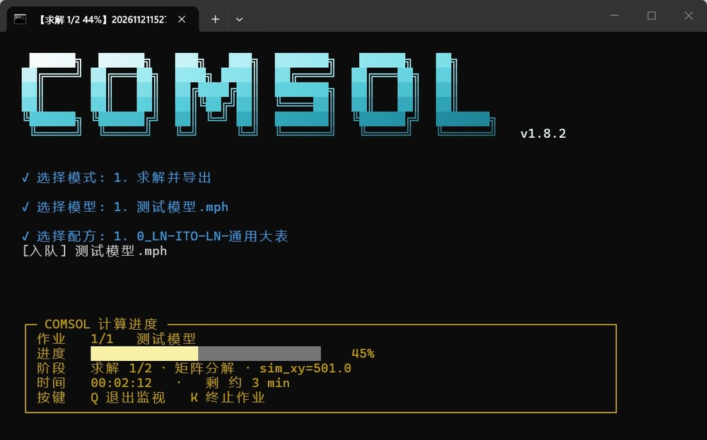

<p align="center"></p>

<p align="center"><b>在远程或公共电脑上批量求解 COMSOL 模型、自动导出数据，只回传结果</b></p>

<p align="center">
  <a href="https://github.com/meaning-infinite/comsol-export-cli/releases"></a>
  
  
  
</p>

<p align="center"></p>

## 特性

- **不用守着**：选完模型和配方就交给后台，求解、导出、命名一路做完
- **窗口关了也不丢**：重开后接着等、或补做导出，计算进程不受影响
- **产物归拢**：每次作业独立目录，回传 CSV、图片和 `EXPORT_MANIFEST.md`
- **换导出内容不改代码**：配方声明用哪些模块、覆盖哪些参数
- **看得见进度**：单行、方框、阶段链三种样式，原地刷新不滚屏
- **多解不出错**：按块显式取数并逐块核对列数，几百个波长也不会悄悄少列

## 快速开始

```powershell
git clone https://github.com/meaning-infinite/comsol-export-cli.git
```

1. 把 `.mph` 放进 `models/`
2. 双击 `run.bat`，等待 COMSOL 安装和驱动检查通过，再依次选择模式、模型和配方
3. 结束后从 `output/` 取结果

适配 Windows PowerShell 5.1 和 COMSOL 6.1–6.4。6.2、6.4 已在本机从正式入口导出已有解。6.1、6.3 已核对公共 API，仍待对应安装实测。模型文件须与所选 COMSOL 版本兼容。启动时优先检查已保存的安装路径。首次使用或原路径失效时会查找本机安装，找到多个版本时先让你选择。模式菜单前会用所选安装的 Java 实测驱动接口。标准安装只加载预检所需的 API 库。

## 命令行

| 命令 | 作用 |
|---|---|
| `run.bat` | 交互启动：选模式、选模型、选配方 |
| `run.bat -Mode export` | 只导出，跳过求解 |
| `run.bat -Recipe "配方A,配方B"` | 每个所选模型使用这两份配方 |
| `run.bat -Mode watch` | 只读监视，可与调度窗口同时打开 |
| `run.bat -Resume` | 接管未完成作业、衔接导出并启动待办 |
| `run.bat -KillJob <作业ID>` | 终止该活动作业，ID 见作业列表。数字兼容队列历史序号 |
| `run.bat -Setup` | 修改 COMSOL 路径、模型目录 |
| `run.bat -DryRun` | 只打印作业计划，不写队列、不计算 |
| `run.bat -Cores 8` | 每作业核数 |
| `run.bat -Heap 8g` | 每作业 Java 堆上限 |
| `run.bat -Modules` | 列出预制模块与可覆盖参数 |

模型和配方都可用方向键移动、空格勾选、回车确认，`A` 全选。每个模型只提交一个作业，同一研究求解一次，随后按所选配方依次导出。不同配方产生同名文件时，后一个配方在文件名前缀中加入配方名。

可以多次打开 `run.bat`，每个窗口选自己的模型。选好配方后直接确认。在 Windows 上，COMSOL 使用首选项指定的核数，未指定时默认使用可用物理核。导出用的 Java 堆由 JVM 管理。需要限制单个作业时，可指定 `-Cores` 或 `-Heap`。所有窗口共用队列，`-Mode watch` 查看活动作业，`-Resume` 接回后台作业。[COMSOL 多核说明](https://www.comsol.com/support/knowledgebase/1096)

同时处理多个模型时，每个模型显示完整进度框，包含阶段、进度、已用和剩余时间。窗口较矮时，用 `PgUp` / `PgDn` 整框翻页。

波长域、频域求解和导出在进度变化较快时用近期速度估时，变化慢时用当前阶段的累计完成量和耗时。重开窗口也能用已记录的阶段起点估时。特征频率求解仍显示阶段、已用时间及日志提供的迭代信息。

波长扫描的进度取自 COMSOL 日志。若窗口长时间停在同一百分比，运行 `update.bat` 后另开窗口执行 `run.bat -Mode watch`，即可查看原作业的最新进度和扫描参数。求解器报错时窗口显示原因。新作业还会记录 `comsolbatch` 的退出码，求解失败时跳过导出，原因写入 `EXPORT_MANIFEST.md`。

**GPU 求解**　CLI 使用模型中启用的求解器，沿用运行账户和 COMSOL 版本的默认首选项。6.4 电磁频域或特征频率模型需要在实际使用的直接线性求解器中选择 **NVIDIA cuDSS**，才能用 GPU 加速该步。图形渲染加速只作用于显示。运行时可在作业目录核对 `launch-solve.txt` 的命令和 `solve.log` 的求解器信息。[COMSOL 批处理说明](https://doc.comsol.com/6.4/doc/com.comsol.help.comsol/comsol_ref_running.38.31.html) · [GPU 求解器说明](https://doc.comsol.com/6.4/doc/com.comsol.help.comsol/comsol_ref_solver.36.173.html)

对比 PARDISO 和 cuDSS 时，分别保存两份已求解模型，运行 `run.bat -Mode export -Recipe "99_求解器历史记录导出"`。在各自的 `*_solver_history.txt` 查同一研究的“上次计算耗时”，再按节点核对自由度、求解阶段和内存。同一台机器上应保持网格、扫描点和核数相同，并记录同期 CPU 负载。使用“求解并导出”时，配方也会带出本作业的原始 `*_solver_history_batch.log`。

## 配方

导出内容全在 `recipes/*.psd1`。配方声明用哪些模块、覆盖哪些参数：

```powershell
@{
    Task = 'ITO-LN-ITO'; Study = 'std1'
    NameTemplate = '{model}'
    Use = @(
        @{ Module = 'spectrum'; Name = 'spectrum' }
        @{ Module = 'slice2d';  Name = 'field'; Planes = @('xy','zx','yz') }
    )
}
```

| 模块 | 产出 |
|---|---|
| `table` | 任意表达式的数据表，每解一行 |
| `spectrum` | 透射/反射谱，附曲线图 |
| `slice2d` | 指定平面的二维场图 |
| `image` | 单点场图总表，三维加三切面拼成一张 |
| `modes` | 特征频率等模态数据 |
| `integral` | 线、面积分 |
| `bigtable` | 全局参数、谱线、分域吸收合成一张大表 |
| `solverlog` | 研究耗时、模型保留的求解器与扫描日志 |

模块位于 `script/modules/`，新增能力只需在 `driver/ExportDriver.java` 的 `HANDLERS` 中注册。

## 输出与交接

```text
output/
  模型A/
    模型A.csv
    EXPORT_MANIFEST.md
  模型B/
    模型B.csv
    EXPORT_MANIFEST.md
```

勾选一个或多个模型时，每个模型各占一个文件夹。CSV、场图、求解记录和 `EXPORT_MANIFEST.md` 都直接放在里面。文件名前缀由配方的 `NameTemplate` 决定，求解后的模型保存为 `models/solved/<输出名>.mph`。

如果已有同名结果，CLI 使用同层的 `模型A (2)`、`模型A (3)` 文件夹，里面的结果文件保留原名。已占用的同名解文件也按此规则另存。旧作业续跑时使用提交时记录的路径。

每行 CSV 保留研究、解节点、节点内序号及全局序号。复现单点场图时，把 `solution_index` 填入 `SolNum`。宽谱吸收使用含全部衍射级的总透射和总反射。

## 离线更新

在发布目录运行 `powershell -ExecutionPolicy Bypass -File pack.ps1`，把生成的 `_dist/*.zip` 带到目标机，执行 `update.bat -Offline "D:\transfer\包名.zip"`。更新器先核对模块、驱动、配方、文档和图片及其 SHA-256，再安装并备份被替换文件。输入 ZIP 可重复使用。

首次从 1.8.x 离线升级时，先将新 ZIP 解压至临时目录。用包内新版 `update.ps1 -Offline <ZIP绝对路径> -InstallDir <现有script目录>` 启动升级。

## 开发

改 `driver/ExportDriver.java` 后须重新编译，内部类才能一并生成：

```bat
set COMSOL=D:\COMSOL\COMSOL62\Multiphysics
"%COMSOL%\java\win64\jre\bin\javac.exe" -encoding UTF-8 -proc:none -source 11 -target 11 ^
    -cp "%COMSOL%\plugins\*" -d driver driver\ExportDriver.java
```

脚本与模块文件须存为 UTF-8 带 BOM，否则 PowerShell 5.1 按 GBK 解码导致整份脚本无法解析。发布驱动使用 Java 11 类文件格式。

`tests/menu.ps1` 检查启动，`tests/queue.ps1` 检查队列和估时，`tests/concurrent.ps1` 用模拟求解器验证多窗口并发与续跑，`tests/package.ps1` 验证离线更新。这些测试使用独立临时目录。

## 文档

- 接口与扩展：[docs/API.md](docs/API.md)
- 配方字段：[recipes/README.md](recipes/README.md)
- COMSOL Java API 笔记：[docs/COMSOL-API.md](docs/COMSOL-API.md)
